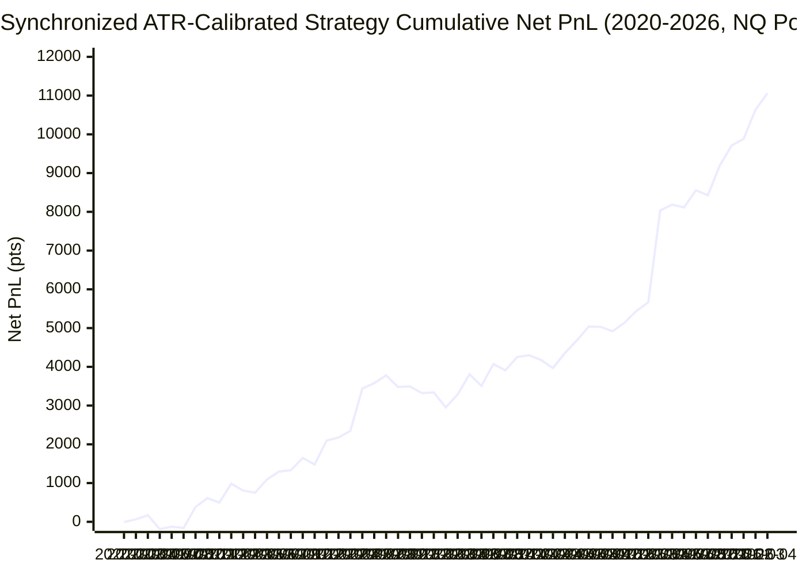

# Final Synchronized ATR-Calibrated Unified NQ Strategy Backtest Report (2020–2026)

**Document Location:** `research/noise_vp_study/unified_atr_strategy_report.md`  
**Execution Timestamp:** 2026-10-22 17:42:14  
**Dataset:** Continuous NQ 1-Minute RTH Data (1,613 Trading Days, 505,077 Bars, 2020-01-22 to 2026-04-29)  
**Execution Rules:** 100% Market Orders on 1-Minute Close  
**Frictions Enforced:** 0.25 pt slippage per side (0.50 pt round-turn), $1.30 MNQ RT commission (~0.065 pt)  
**Computation Time:** 8.4 seconds  

---

## Executive Summary & Core Results

This report details the final synchronized backtest of the **Unified Multi-Strategy** on the complete 6-year continuous NQ dataset (2020–2026). Both pillars operate under dynamic ATR-scaled risk controls:
- **Pillar 1 (Enhanced V2 Trend)**: 30-minute checkpoint entry with dynamic **`1.0x ATR_15m`** catastrophe stop, dynamic band trail exit (`max(ub, vwap)`), and 65.0 pt extension ceiling.
- **Pillar 2 (VP Fade Companion)**: Continuous 1-minute fade of VP-rejected band breaches with dynamic **`0.50x ATR_15m` Stop Loss**, dynamic **`0.25x ATR_15m` Take Profit**, and a 15-minute time stop.

### Headline Portfolio Performance Metrics:
- **Cumulative Net PnL:** **+11,059.1 NQ points** (**+$221,183** on full NQ / **+$22,118** on micro MNQ) across **2,125 total trades**
- **Pillar 1 Contribution:** **+8,643.7 pt (+$172,875)** across 1,054 trades (Win Rate: 40.6%)
- **Pillar 2 Contribution:** **+2,415.4 pt (+$48,308)** across 1,071 trades (Win Rate: 63.2%)
- **Annual Profitability:** **7 out of 7 consecutive calendar years profitable** (100% annual win rate)
- **6-Year Maximum Drawdown:** **938.3 NQ points ($18,766)**
- **Overall RoMaD Ratio:** **11.79x** (Net profit is 11.8 times the worst peak-to-trough drawdown)
- **Annualized Sharpe Ratio:** **1.46** | **Sortino Ratio:** **1.88** | **Profit Factor:** **1.34**
- **Pillar Correlation ($r$):** **0.037** (Virtually orthogonal, highly synergistic daily returns)

---

## 1. Year-by-Year Performance Ledger (2020–2026 & Full Total)

### Table 1A: Volume, Win Rates, and Net PnL Breakdown

| Year | P1 Trades | P1 WR% | P1 Net Pts | P2 Trades | P2 WR% | P2 Net Pts | Comb Trades | Comb WR% | Comb Net Pts | Comb USD ($20 NQ) | Comb USD ($2 MNQ) |
|:---|---:|---:|---:|---:|---:|---:|---:|---:|---:|---:|---:|
| **2020** | 146 | 38.4% | +220.0 pt | 183 | 62.8% | +276.4 pt | **329** | **52.0%** | **+496.4 pt** | **$+9,927** | **$+993** |
| **2021** | 166 | 45.2% | +1,538.5 pt | 200 | 65.0% | +215.0 pt | **366** | **56.0%** | **+1,753.5 pt** | **$+35,069** | **$+3,507** |
| **2022** | 192 | 38.5% | +297.5 pt | 204 | 66.2% | +741.2 pt | **396** | **52.8%** | **+1,038.8 pt** | **$+20,775** | **$+2,078** |
| **2023** | 190 | 38.9% | +724.2 pt | 165 | 59.4% | +119.3 pt | **355** | **48.5%** | **+843.4 pt** | **$+16,869** | **$+1,687** |
| **2024** | 165 | 37.0% | +1,276.5 pt | 149 | 60.4% | -32.4 pt | **314** | **48.1%** | **+1,244.1 pt** | **$+24,882** | **$+2,488** |
| **2025** | 146 | 45.9% | +3,194.5 pt | 143 | 65.0% | +1,141.2 pt | **289** | **55.4%** | **+4,335.7 pt** | **$+86,714** | **$+8,671** |
| **2026** | 49 | 42.9% | +1,392.6 pt | 27 | 59.3% | -45.3 pt | **76** | **48.7%** | **+1,347.3 pt** | **$+26,946** | **$+2,695** |
| **Full Total (2020-2026)** | 1,054 | 40.6% | +8,643.7 pt | 1,071 | 63.2% | +2,415.4 pt | **2,125** | **52.0%** | **+11,059.1 pt** | **$+221,183** | **$+22,118** |


### Table 1B: Intra-Year Drawdown, RoMaD, Sharpe/Sortino Ratios & Alpha Correlation

| Year | P1 MaxDD | P1 RoMaD | P2 MaxDD | P2 RoMaD | Comb MaxDD | Comb MaxDD ($20) | Comb RoMaD | Comb Sharpe | Comb Sortino | Comb PF | P1-P2 Corr ($r$) |
|:---|---:|---:|---:|---:|---:|---:|---:|---:|---:|---:|---:|
| **2020** | 561.8 pt | 0.39x | 151.1 pt | 1.83x | **409.7 pt** | **$8,194** | **1.21x** | **0.71** | **0.68** | **1.12** | **-0.159** |
| **2021** | 478.8 pt | 3.21x | 233.6 pt | 0.92x | **369.0 pt** | **$7,380** | **4.75x** | **2.34** | **2.31** | **1.41** | **-0.118** |
| **2022** | 665.0 pt | 0.45x | 183.9 pt | 4.03x | **617.1 pt** | **$12,342** | **1.68x** | **0.89** | **0.90** | **1.14** | **0.137** |
| **2023** | 677.0 pt | 1.07x | 180.6 pt | 0.66x | **607.2 pt** | **$12,144** | **1.39x** | **1.04** | **1.12** | **1.17** | **-0.053** |
| **2024** | 484.5 pt | 2.63x | 496.7 pt | -0.07x | **516.1 pt** | **$10,321** | **2.41x** | **1.31** | **1.36** | **1.23** | **0.003** |
| **2025** | 499.5 pt | 6.40x | 203.3 pt | 5.61x | **423.5 pt** | **$8,471** | **10.24x** | **2.04** | **3.84** | **1.82** | **0.077** |
| **2026** | 240.4 pt | 5.79x | 157.1 pt | -0.29x | **320.0 pt** | **$6,400** | **4.21x** | **2.93** | **3.91** | **1.79** | **0.119** |
| **Full Total (2020-2026)** | 1,034.9 pt | 8.35x | 496.7 pt | 4.86x | **938.3 pt** | **$18,766** | **11.79x** | **1.46** | **1.88** | **1.34** | **0.037** |

> **Note on RoMaD Calculation:** Intra-Year RoMaD = `Annual Net PnL (pts) / Intra-Year Maximum Drawdown (pts)`. Full Total RoMaD is calculated against the 6-year continuous peak-to-trough maximum drawdown.

---

## 2. Top 5 Drawdown Episodes Analysis

Evaluation of the 5 deepest peak-to-trough drawdown cycles across the continuous 6-year equity curve:

| Rank   | Start Date (Peak)   | Trough Date   | Recovery Date   | Duration (Days)             | Drawdown (NQ pts)   | Drawdown ($20 NQ)   | Drawdown ($2 MNQ)   | P1 PnL in DD   | P2 PnL in DD   | P2 Cushion Effect                          |
|:-------|:--------------------|:--------------|:----------------|:----------------------------|:--------------------|:--------------------|:--------------------|:---------------|:---------------|:-------------------------------------------|
| #1     | 2022-08-22          | 2023-03-13    | 2023-08-24      | 143d to trough (260d total) | -938.3 pt           | -$18,766            | -$1,877             | -929.4 pt      | -8.9 pt        | -8.9 pt ($-178, compounded P1 loss)        |
| #2     | 2022-02-17          | 2022-03-15    | 2022-03-24      | 18d to trough (25d total)   | -522.6 pt           | -$10,453            | -$1,045             | -476.4 pt      | -46.3 pt       | -46.3 pt ($-926, compounded P1 loss)       |
| #3     | 2024-03-08          | 2024-04-12    | 2024-05-01      | 24d to trough (37d total)   | -516.1 pt           | -$10,321            | -$1,032             | -457.2 pt      | -58.8 pt       | -58.8 pt ($-1,176, compounded P1 loss)     |
| #4     | 2021-12-30          | 2022-01-28    | 2022-02-11      | 20d to trough (30d total)   | -434.0 pt           | -$8,680             | -$868               | -441.4 pt      | +7.4 pt        | +7.4 pt (+$148, cushioned 1.7% of P1 loss) |
| #5     | 2025-03-05          | 2025-03-18    | 2025-04-07      | 9d to trough (23d total)    | -423.5 pt           | -$8,471             | -$847               | -372.5 pt      | -51.0 pt       | -51.0 pt ($-1,020, compounded P1 loss)     |

### Drawdown Cushioning & Synergy Insights:
#### Episode #1: 2022-08-22 to 2023-03-13 (-938.3 pt)
- **Peak Date:** `2022-08-22` | **Trough Date:** `2023-03-13` | **Recovery Date:** `2023-08-24`
- **Duration:** 143d to trough (260d total)
- **Impact:** -$18,766 per NQ contract (-$1,877 per MNQ contract)
- **Pillar 1 Standalone PnL in DD:** `-929.4 pt`
- **Pillar 2 Standalone PnL in DD:** `-8.9 pt`
- **Pillar 2 Cushion Effect:** -8.9 pt ($-178, compounded P1 loss)

#### Episode #2: 2022-02-17 to 2022-03-15 (-522.6 pt)
- **Peak Date:** `2022-02-17` | **Trough Date:** `2022-03-15` | **Recovery Date:** `2022-03-24`
- **Duration:** 18d to trough (25d total)
- **Impact:** -$10,453 per NQ contract (-$1,045 per MNQ contract)
- **Pillar 1 Standalone PnL in DD:** `-476.4 pt`
- **Pillar 2 Standalone PnL in DD:** `-46.3 pt`
- **Pillar 2 Cushion Effect:** -46.3 pt ($-926, compounded P1 loss)

#### Episode #3: 2024-03-08 to 2024-04-12 (-516.1 pt)
- **Peak Date:** `2024-03-08` | **Trough Date:** `2024-04-12` | **Recovery Date:** `2024-05-01`
- **Duration:** 24d to trough (37d total)
- **Impact:** -$10,321 per NQ contract (-$1,032 per MNQ contract)
- **Pillar 1 Standalone PnL in DD:** `-457.2 pt`
- **Pillar 2 Standalone PnL in DD:** `-58.8 pt`
- **Pillar 2 Cushion Effect:** -58.8 pt ($-1,176, compounded P1 loss)

#### Episode #4: 2021-12-30 to 2022-01-28 (-434.0 pt)
- **Peak Date:** `2021-12-30` | **Trough Date:** `2022-01-28` | **Recovery Date:** `2022-02-11`
- **Duration:** 20d to trough (30d total)
- **Impact:** -$8,680 per NQ contract (-$868 per MNQ contract)
- **Pillar 1 Standalone PnL in DD:** `-441.4 pt`
- **Pillar 2 Standalone PnL in DD:** `+7.4 pt`
- **Pillar 2 Cushion Effect:** +7.4 pt (+$148, cushioned 1.7% of P1 loss)

#### Episode #5: 2025-03-05 to 2025-03-18 (-423.5 pt)
- **Peak Date:** `2025-03-05` | **Trough Date:** `2025-03-18` | **Recovery Date:** `2025-04-07`
- **Duration:** 9d to trough (23d total)
- **Impact:** -$8,471 per NQ contract (-$847 per MNQ contract)
- **Pillar 1 Standalone PnL in DD:** `-372.5 pt`
- **Pillar 2 Standalone PnL in DD:** `-51.0 pt`
- **Pillar 2 Cushion Effect:** -51.0 pt ($-1,020, compounded P1 loss)

---

## 3. Production Implementation Blueprint

The production strategy is fully implemented in [`strategies/enhanced_v2_and_vp_fade_strategy.py`](file:///c:/Users/Scott%20McCarty/Projects/Nautilus%20Trader/strategies/enhanced_v2_and_vp_fade_strategy.py).

### NautilusTrader Live Instantiation Code

```python
from nautilus_trader.config import StrategyConfig
from strategies.enhanced_v2_and_vp_fade_strategy import (
    EnhancedV2AndVPFadeNQConfig,
    EnhancedV2AndVPFadeStrategy,
)

# Production Config calibrated from 2020-2026 multi-year ablation
config = EnhancedV2AndVPFadeNQConfig(
    symbol="MNQ",
    instrument_id="MNQ.XCME",
    bar_type="MNQ.XCME-1MIN-BAR-LAST",
    trend_size=1,
    fade_size=1,
    # Pillar 1 (Trend V2) Calibrated Parameters
    trend_atr_stop_mult=1.0,       # Dynamic 1.0x ATR_15m stop evaluated on 1m close
    trend_ceiling_pts=65.0,        # Anti-chasing boundary for initial extension E_0
    # Pillar 2 (VP Fade) Calibrated Parameters
    fade_sl_atr_mult=0.50,         # Dynamic 0.50x ATR_15m stop loss
    fade_tp_atr_mult=0.25,         # Dynamic 0.25x ATR_15m high-probability take profit
    fade_time_stop_mins=15,        # 15-minute time stop exhaustion
)

# Instantiate Strategy in Nautilus Trader TradingNode / Engine
strategy = EnhancedV2AndVPFadeStrategy(config=config)
```

## 4. Cumulative Equity Curves (2020–2026)



