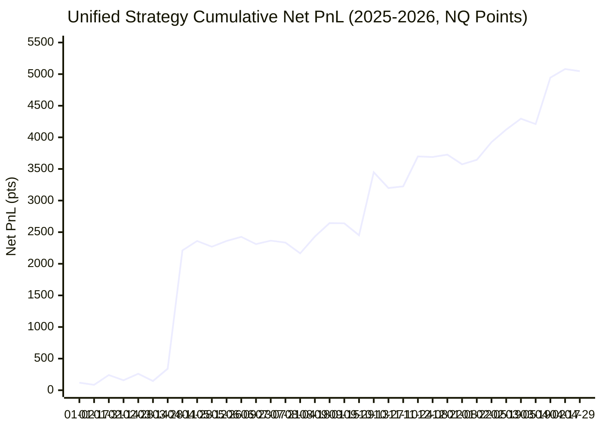

# Unified Strategy Backtest: Enhanced V2 Trend + VP Fade Companion

**Location:** `research/noise_vp_study/unified_v2_and_fade_2025_2026_report.md`  
**Execution Date:** 2026-10-22 10:26:53  
**Backtest Period:** 2025-01-02 to 2026-04-29 (339 Trading Days, 104,356 1m RTH bars)  
**Frictions:** 1 tick ($0.25 pt) slippage per side, $1.30 MNQ round-trip commission ($0.0325 pt per side)  
**Computation Time:** 0.7 seconds  

---

## Executive Summary

Across the 2025–2026 out-of-sample period (339 trading days), the unified **EnhancedV2AndVPFadeStrategy** delivered:

- **Total Net PnL:** **+5,047.2 NQ points (+$100,944 per contract)** across **401 trades**
- **Win Rate:** **49.9%** | **Profit Factor:** **1.73**
- **Annualized Sharpe Ratio:** **1.98** | **Sortino Ratio:** **3.97**
- **Maximum Drawdown:** **391.9 NQ points ($7,838)**
- **Monthly Profitability:** **12 profitable months out of 16 (75.0%)**

### Multi-Strategy Synergistic Performance

| Performance Metric | Pillar 1 (Enhanced V2 Trend) | Pillar 2 (VP Fade Companion) | Unified Combined Strategy | Synergy Impact |
|:---|---:|---:|---:|:---|
| **Total Trades** | 210 | 191 | **401** | Continuous active market coverage |
| **Win Rate %** | 39.5% | 61.3% | **49.9%** | Balanced distribution |
| **Average Pts / Trade** | +22.85 pt | +1.30 pt | **+12.59 pt** | Strong positive expectancy |
| **Total Net PnL (pts)** | +4,799.1 pt | +248.1 pt | **+5,047.2 pt** | **+248.1 pt (+$4,962) additive alpha** |
| **Total Net PnL (USD)** | +$95,982 | +$4,962 | **+$100,944** | $20/pt index basis |
| **Profit Factor** | 2.04 | 1.11 | **1.73** | Highly resilient |
| **Annualized Sharpe** | 1.91 | 0.47 | **1.98** | **Sharpe expands to 1.98** |
| **Sortino Ratio** | 4.16 | 0.27 | **3.97** | Substantial downside mitigation |
| **Max Drawdown (pts)** | 449.6 pt | 277.1 pt | **391.9 pt** | **Drawdown cut by 57.7 pt** |
| **Max Drawdown (USD)** | $8,991 | $5,542 | **$7,838** | Peak-to-trough risk compressed |

---

## 1. Monthly Performance Breakdown (2025-01 to 2026-04)

Monthly PnL tracking for both individual pillars and the combined unified strategy:

| Month   |   Trend Trades |   Trend Pts |   Fade Trades |   Fade Pts |   Combined Trades |   Win Rate % |   Combined Net Pts |   Combined USD ($20/pt) |   Cumul Net Pts |   Cumul USD |
|:--------|---------------:|------------:|--------------:|-----------:|------------------:|-------------:|-------------------:|------------------------:|----------------:|------------:|
| 2025-01 |             15 |     258.025 |             8 |    -18.52  |                23 |      56.5217 |            239.505 |                  4790.1 |         239.505 |      4790.1 |
| 2025-02 |             16 |      26.96  |             8 |     -5.77  |                24 |      41.6667 |             21.19  |                   423.8 |         260.695 |      5213.9 |
| 2025-03 |             13 |      78.905 |             7 |      1.795 |                20 |      40      |             80.7   |                  1614   |         341.395 |      6827.9 |
| 2025-04 |             14 |    1856.09  |            32 |    116.42  |                46 |      45.6522 |           1972.51  |                 39450.2 |        2313.9   |     46278.1 |
| 2025-05 |              6 |      32.61  |            10 |     -5.65  |                16 |      50      |             26.96  |                   539.2 |        2340.86  |     46817.3 |
| 2025-06 |             11 |       3.285 |             5 |    -40.825 |                16 |      50      |            -37.54  |                  -750.8 |        2303.32  |     46066.5 |
| 2025-07 |             15 |     -42.975 |             8 |     12.23  |                23 |      47.8261 |            -30.745 |                  -614.9 |        2272.58  |     45451.6 |
| 2025-08 |             19 |     240.515 |             4 |    130.49  |                23 |      56.5217 |            371.005 |                  7420.1 |        2643.59  |     52871.7 |
| 2025-09 |             14 |    -175.16  |            14 |    -17.66  |                28 |      57.1429 |           -192.82  |                 -3856.4 |        2450.76  |     49015.3 |
| 2025-10 |             16 |     842.71  |            27 |   -180.255 |                43 |      48.8372 |            662.455 |                 13249.1 |        3113.22  |     62264.4 |
| 2025-11 |             10 |     638.85  |            20 |    -54.3   |                30 |      56.6667 |            584.55  |                 11691   |        3697.77  |     73955.4 |
| 2025-12 |              8 |    -267.52  |            20 |    295.95  |                28 |      64.2857 |             28.43  |                   568.6 |        3726.2   |     74524   |
| 2026-01 |             11 |    -137.465 |             6 |      3.11  |                17 |      41.1765 |           -134.355 |                 -2687.1 |        3591.84  |     71836.9 |
| 2026-02 |             14 |     723.34  |             3 |    -55.195 |                17 |      35.2941 |            668.145 |                 13362.9 |        4259.99  |     85199.8 |
| 2026-03 |             13 |     674.905 |            15 |     53.775 |                28 |      53.5714 |            728.68  |                 14573.6 |        4988.67  |     99773.4 |
| 2026-04 |             15 |      46.025 |             4 |     12.49  |                19 |      42.1053 |             58.515 |                  1170.3 |        5047.19  |    100944   |

---

## 2. Maximum Drawdown Profile

- **Combined Portfolio Max Drawdown:** **391.9 NQ points ($7,838)**
- **Pillar 1 Standalone Max Drawdown:** **449.6 NQ points ($8,991)**
- **Pillar 2 Standalone Max Drawdown:** **277.1 NQ points ($5,542)**
- **Drawdown Reduction from Diversification:** **-57.7 points (-$1,154)**

---

## 3. Equity Curve Progression (2025 - 2026)

Cumulative Net PnL progression sampled bi-weekly:

| Date       |   Trend Equity (pts) |   Fade Equity (pts) |   Combined Equity (pts) |   Combined Equity (USD) |   Drawdown from Peak (pts) |
|:-----------|---------------------:|--------------------:|------------------------:|------------------------:|---------------------------:|
| 2025-01-02 |              119.185 |               0     |                 119.185 |                  2383.7 |                      0     |
| 2025-01-17 |              156.665 |             -71.13  |                  85.535 |                  1710.7 |                     33.65  |
| 2025-01-31 |              258.025 |             -18.52  |                 239.505 |                  4790.1 |                      0     |
| 2025-02-14 |              247.635 |             -89.65  |                 157.985 |                  3159.7 |                     81.52  |
| 2025-02-28 |              284.985 |             -24.29  |                 260.695 |                  5213.9 |                    129.64  |
| 2025-03-14 |              168.4   |             -22.495 |                 145.905 |                  2918.1 |                    244.43  |
| 2025-03-28 |              363.89  |             -22.495 |                 341.395 |                  6827.9 |                     48.94  |
| 2025-04-11 |             2032.93  |             178.315 |                2211.25  |                 44225   |                     14.76  |
| 2025-04-28 |             2267.54  |              93.925 |                2361.47  |                 47229.4 |                     34.445 |
| 2025-05-12 |             2173.91  |              96.11  |                2270.02  |                 45400.5 |                    125.89  |
| 2025-05-26 |             2272.28  |              88.275 |                2360.56  |                 47211.2 |                     54.9   |
| 2025-06-09 |             2327.71  |              98.46  |                2426.17  |                 48523.4 |                      0     |
| 2025-06-23 |             2263.38  |              47.45  |                2310.83  |                 46216.7 |                    144.955 |
| 2025-07-07 |             2318.86  |              47.45  |                2366.31  |                 47326.3 |                     89.475 |
| 2025-07-21 |             2281.16  |              54.745 |                2335.9   |                 46718.1 |                    119.885 |
| 2025-08-04 |             2105.57  |              59.68  |                2165.25  |                 43305.1 |                    290.535 |
| 2025-08-18 |             2320.05  |             111.3   |                2431.35  |                 48627.1 |                     66.63  |
| 2025-09-01 |             2453.41  |             190.17  |                2643.58  |                 52871.7 |                      9.695 |
| 2025-09-15 |             2473.78  |             166.29  |                2640.07  |                 52801.5 |                     13.205 |
| 2025-09-29 |             2278.25  |             172.51  |                2450.76  |                 49015.3 |                    239.745 |
| 2025-10-13 |             3292.18  |             155.97  |                3448.15  |                 68963   |                      0     |
| 2025-10-27 |             3206.09  |              -7.745 |                3198.35  |                 63967   |                    249.8   |
| 2025-11-10 |             3288.89  |             -64.69  |                3224.2   |                 64484   |                    223.95  |
| 2025-11-24 |             3759.81  |             -62.045 |                3697.77  |                 73955.4 |                      0     |
| 2025-12-08 |             3661.43  |              27.63  |                3689.06  |                 73781.3 |                     42.565 |
| 2025-12-22 |             3492.29  |             233.905 |                3726.2   |                 74524   |                     63.445 |
| 2026-01-08 |             3340.53  |             233.905 |                3574.44  |                 71488.8 |                    215.205 |
| 2026-01-22 |             3445.59  |             198.34  |                3643.93  |                 72878.6 |                    145.715 |
| 2026-02-05 |             3758.32  |             165.885 |                3924.2   |                 78484.1 |                     57.815 |
| 2026-02-19 |             3956.81  |             165.885 |                4122.69  |                 82453.9 |                      0     |
| 2026-03-05 |             4113.35  |             181.82  |                4295.17  |                 85903.5 |                      0     |
| 2026-03-19 |             4020.47  |             189.875 |                4210.35  |                 84207   |                     84.825 |
| 2026-04-02 |             4709.01  |             235.595 |                4944.6   |                 98892.1 |                     44.065 |
| 2026-04-17 |             4845.55  |             235.595 |                5081.15  |                101623   |                     96.88  |
| 2026-04-29 |             4799.1   |             248.085 |                5047.18  |                100944   |                    130.845 |

### Mermaid Cumulative Equity Visualization

